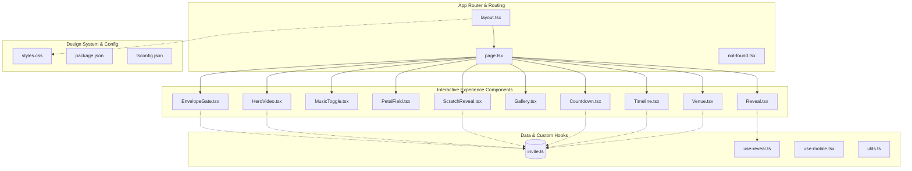

# Onboarding Guide: Enchanted Wedding Invitation (`wedding-invitation`)

Welcome to the **Enchanted Wedding Invitation** codebase! This guide is designed to get you up to speed with the architecture, interactive animation pipelines, media playback controllers, component hierarchy, and domain models.

---

## 1. Project Overview

- **Project Name**: `wedding-invitation`
- **Primary Languages**: TypeScript, TSX, CSS, JSON, Markdown
- **Core Framework & Libraries**:
  - [Next.js 15](https://nextjs.org/) (App Router, Client Components)
  - [React 19](https://react.dev/)
  - [Tailwind CSS v4](https://tailwindcss.com/) & [tw-animate-css](https://www.npmjs.com/package/tw-animate-css)
  - [Radix UI](https://www.radix-ui.com/) & [shadcn/ui](https://ui.shadcn.com/) component primitives
  - [Lucide React](https://lucide.dev/) (Iconography)
- **Concept**: An enchanted cinematic digital wedding invitation web experience for **Inshu & Archit**. It features an opening 3D envelope gate with gold wax seal, video hero background with scroll parallax, synchronized YouTube audio loop playback, an HTML5 Canvas heart-shaped scratch card with dynamic `.ics` calendar generation, touch-gesture photo gallery, real-time countdown timer, event itinerary timeline, and venue location mapping.

---

## 2. Architecture Layers

### Layer Details:

1. **App Router & Entry Layer (`layer:app-routing`)**
   - [src/app/layout.tsx](file:///e:/Shashank%20bhaiya%20invites/female-prespective-insu%20invite/src/app/layout.tsx): Root layout configuring HTML metadata, viewport tags, typography font classes, and global CSS.
   - [src/app/page.tsx](file:///e:/Shashank%20bhaiya%20invites/female-prespective-insu%20invite/src/app/page.tsx): Main client component orchestrating the top-level reveal sequence and section composition.
   - [src/app/not-found.tsx](file:///e:/Shashank%20bhaiya%20invites/female-prespective-insu%20invite/src/app/not-found.tsx): Themed 404 handler.

2. **Interactive Experience Components Layer (`layer:interactive-experience`)**
   - [src/components/invite/EnvelopeGate.tsx](file:///e:/Shashank%20bhaiya%20invites/female-prespective-insu%20invite/src/components/invite/EnvelopeGate.tsx): 3D CSS transform envelope with wax seal, flap opening, and sliding card.
   - [src/components/invite/HeroVideo.tsx](file:///e:/Shashank%20bhaiya%20invites/female-prespective-insu%20invite/src/components/invite/HeroVideo.tsx): Video loop with scroll-based parallax transformation and typography overlay.
   - [src/components/invite/MusicToggle.tsx](file:///e:/Shashank%20bhaiya%20invites/female-prespective-insu%20invite/src/components/invite/MusicToggle.tsx): YouTube IFrame API audio bridge supporting autoplay-on-unlock and looping.
   - [src/components/invite/ScratchReveal.tsx](file:///e:/Shashank%20bhaiya%20invites/female-prespective-insu%20invite/src/components/invite/ScratchReveal.tsx): HTML5 Canvas scratchable heart with dynamic `.ics` calendar exporter.
   - [src/components/invite/Gallery.tsx](file:///e:/Shashank%20bhaiya%20invites/female-prespective-insu%20invite/src/components/invite/Gallery.tsx): Touch-drag and pointer-capture photo carousel with keyboard accessibility.
   - [src/components/invite/Countdown.tsx](file:///e:/Shashank%20bhaiya%20invites/female-prespective-insu%20invite/src/components/invite/Countdown.tsx): Real-time countdown timer to the wedding date.
   - [src/components/invite/Timeline.tsx](file:///e:/Shashank%20bhaiya%20invites/female-prespective-insu%20invite/src/components/invite/Timeline.tsx): Itinerary events for Haldi, Mehendi, Bhaat, Sangeet, and Wedding.
   - [src/components/invite/Venue.tsx](file:///e:/Shashank%20bhaiya%20invites/female-prespective-insu%20invite/src/components/invite/Venue.tsx): Resort details, address, and Google Maps direct link.
   - [src/components/invite/PetalField.tsx](file:///e:/Shashank%20bhaiya%20invites/female-prespective-insu%20invite/src/components/invite/PetalField.tsx): Ambient falling rose petals particle simulation.
   - [src/components/invite/Reveal.tsx](file:///e:/Shashank%20bhaiya%20invites/female-prespective-insu%20invite/src/components/invite/Reveal.tsx): Intersection Observer animation container, section titles, and gold heart dividers.

3. **Data Model & Custom Hooks Layer (`layer:data-and-hooks`)**
   - [src/data/invite.ts](file:///e:/Shashank%20bhaiya%20invites/female-prespective-insu%20invite/src/data/invite.ts): Single source of truth for shloka, family names, timeline events, coordinates, and RSVP.
   - [src/hooks/use-reveal.ts](file:///e:/Shashank%20bhaiya%20invites/female-prespective-insu%20invite/src/hooks/use-reveal.ts): Viewport intersection observer hook for smooth on-scroll animations.
   - [src/hooks/use-mobile.tsx](file:///e:/Shashank%20bhaiya%20invites/female-prespective-insu%20invite/src/hooks/use-mobile.tsx): Mobile viewport detector hook.
   - [src/lib/utils.ts](file:///e:/Shashank%20bhaiya%20invites/female-prespective-insu%20invite/src/lib/utils.ts): Tailwind CSS class-merging helper (`cn`).

4. **Design System & Configuration Layer (`layer:design-and-config`)**
   - [src/styles.css](file:///e:/Shashank%20bhaiya%20invites/female-prespective-insu%20invite/src/styles.css): OKLCH colors, 3D envelope keyframes, gold gradients, and typography rules.
   - [package.json](file:///e:/Shashank%20bhaiya%20invites/female-prespective-insu%20invite/package.json) & [tsconfig.json](file:///e:/Shashank%20bhaiya%20invites/female-prespective-insu%20invite/tsconfig.json): Next.js build environment and TypeScript paths.

---

## 3. Key Concepts & Design Patterns

### 1. Gate Unlock Sequence
The app opens with an immersive `<EnvelopeGate />` overlay (`z-index: 50`). When tapped:
1. Envelope flap rotates along the X axis in 3D (`perspective: 1500px`).
2. Gold card slides vertically upwards (`card-emerge` keyframe).
3. `onOpen()` callback informs `page.tsx` (`opened = true`).
4. `PetalField` triggers ambient falling petals.
5. `MusicToggle` starts background audio playback.
6. The gate overlay transitions out and is unmounted after 2800ms.

### 2. Audio Lifecycle & YouTube IFrame Bridge
Rather than relying on raw MP3 files subject to strict browser autoplay policies, `MusicToggle.tsx` loads the YouTube IFrame API:
- Embeds a 1x1 hidden player for track `rtOvBOTyX00`.
- Limits playback loop between seconds `17` (start) and `80` (end).
- Starts automatically once user taps to open the envelope (satisfying browser user-gesture requirements).

### 3. HTML5 Canvas Scratch Card & iCalendar (.ics) Export
`ScratchReveal.tsx` utilizes HTML5 Canvas 2D:
- Fills heart-clipped canvas with a pink/gold sparkle gradient.
- Erases pixels on pointer drag using `globalCompositeOperation = 'destination-out'`.
- Calculates percentage of clear alpha pixels; once >50% is scratched, it transitions `revealed = true`.
- Clicking "Save the date" builds a dynamic RFC 5545 `VEVENT` blob and triggers instant download of `inshu-archit-wedding.ics`.

---

## 4. Guided Tour (Recommended Learning Path)

| Step | Focus Area | Key Files | Description |
|---|---|---|---|
| **1** | **Project Entry** | [README.md](file:///e:/Shashank%20bhaiya%20invites/female-prespective-insu%20invite/README.md), [src/app/page.tsx](file:///e:/Shashank%20bhaiya%20invites/female-prespective-insu%20invite/src/app/page.tsx) | Inspect the main application structure and section composition. |
| **2** | **3D Envelope Gate** | [EnvelopeGate.tsx](file:///e:/Shashank%20bhaiya%20invites/female-prespective-insu%20invite/src/components/invite/EnvelopeGate.tsx), [styles.css](file:///e:/Shashank%20bhaiya%20invites/female-prespective-insu%20invite/src/styles.css) | Study the 3D CSS keyframe animations, flap flipping, and card emerge motion. |
| **3** | **Audio Subsystem** | [MusicToggle.tsx](file:///e:/Shashank%20bhaiya%20invites/female-prespective-insu%20invite/src/components/invite/MusicToggle.tsx) | Review the YouTube IFrame player initialization and time-boundary looping. |
| **4** | **Hero & Parallax** | [HeroVideo.tsx](file:///e:/Shashank%20bhaiya%20invites/female-prespective-insu%20invite/src/components/invite/HeroVideo.tsx), [PetalField.tsx](file:///e:/Shashank%20bhaiya%20invites/female-prespective-insu%20invite/src/components/invite/PetalField.tsx) | Check the RAF scroll listener for hero text parallax and particle drift. |
| **5** | **Scratch & ICS** | [ScratchReveal.tsx](file:///e:/Shashank%20bhaiya%20invites/female-prespective-insu%20invite/src/components/invite/ScratchReveal.tsx) | Understand canvas compositing and client-side calendar event generation. |
| **6** | **Gallery Gestures** | [Gallery.tsx](file:///e:/Shashank%20bhaiya%20invites/female-prespective-insu%20invite/src/components/invite/Gallery.tsx) | Examine pointer-capture horizontal swipe thresholds and spring translations. |
| **7** | **Timeline & Venue** | [Countdown.tsx](file:///e:/Shashank%20bhaiya%20invites/female-prespective-insu%20invite/src/components/invite/Countdown.tsx), [Timeline.tsx](file:///e:/Shashank%20bhaiya%20invites/female-prespective-insu%20invite/src/components/invite/Timeline.tsx), [Venue.tsx](file:///e:/Shashank%20bhaiya%20invites/female-prespective-insu%20invite/src/components/invite/Venue.tsx) | Follow the date countdown calculation and itinerary event rendering. |
| **8** | **Data Contract** | [invite.ts](file:///e:/Shashank%20bhaiya%20invites/female-prespective-insu%20invite/src/data/invite.ts) | Explore the data model feeding all text, dates, names, and venues. |

---

## 5. File Map

| File | Layer | Summary |
|---|---|---|
| [src/app/page.tsx](file:///e:/Shashank%20bhaiya%20invites/female-prespective-insu%20invite/src/app/page.tsx) | App Router | Main view orchestrating gate unlock, video hero, gallery, countdown, timeline, and venue. |
| [src/app/layout.tsx](file:///e:/Shashank%20bhaiya%20invites/female-prespective-insu%20invite/src/app/layout.tsx) | App Router | Root HTML shell and metadata declaration. |
| [src/components/invite/EnvelopeGate.tsx](file:///e:/Shashank%20bhaiya%20invites/female-prespective-insu%20invite/src/components/invite/EnvelopeGate.tsx) | Interactive Experience | 3D envelope opening animation with wax seal and card slide-up. |
| [src/components/invite/HeroVideo.tsx](file:///e:/Shashank%20bhaiya%20invites/female-prespective-insu%20invite/src/components/invite/HeroVideo.tsx) | Interactive Experience | Full-viewport video background with scroll parallax text. |
| [src/components/invite/MusicToggle.tsx](file:///e:/Shashank%20bhaiya%20invites/female-prespective-insu%20invite/src/components/invite/MusicToggle.tsx) | Interactive Experience | YouTube audio player with looping and auto-trigger on envelope unlock. |
| [src/components/invite/ScratchReveal.tsx](file:///e:/Shashank%20bhaiya%20invites/female-prespective-insu%20invite/src/components/invite/ScratchReveal.tsx) | Interactive Experience | HTML5 Canvas heart scratch card + `.ics` calendar file download. |
| [src/components/invite/Gallery.tsx](file:///e:/Shashank%20bhaiya%20invites/female-prespective-insu%20invite/src/components/invite/Gallery.tsx) | Interactive Experience | Touch drag/swipe photo gallery with smooth transitions. |
| [src/components/invite/Countdown.tsx](file:///e:/Shashank%20bhaiya%20invites/female-prespective-insu%20invite/src/components/invite/Countdown.tsx) | Interactive Experience | Real-time days/hours/minutes/seconds countdown. |
| [src/components/invite/Timeline.tsx](file:///e:/Shashank%20bhaiya%20invites/female-prespective-insu%20invite/src/components/invite/Timeline.tsx) | Interactive Experience | Multi-day wedding itinerary with milestone dots and timings. |
| [src/components/invite/Venue.tsx](file:///e:/Shashank%20bhaiya%20invites/female-prespective-insu%20invite/src/components/invite/Venue.tsx) | Interactive Experience | Venue information card and Google Maps navigation link. |
| [src/components/invite/PetalField.tsx](file:///e:/Shashank%20bhaiya%20invites/female-prespective-insu%20invite/src/components/invite/PetalField.tsx) | Interactive Experience | Falling rose petal ambient background particle animation. |
| [src/components/invite/Reveal.tsx](file:///e:/Shashank%20bhaiya%20invites/female-prespective-insu%20invite/src/components/invite/Reveal.tsx) | Interactive Experience | On-scroll viewport reveal container and gold dividers. |
| [src/data/invite.ts](file:///e:/Shashank%20bhaiya%20invites/female-prespective-insu%20invite/src/data/invite.ts) | Data & Hooks | Centralized wedding invite dataset (couples, parents, dates, itinerary). |
| [src/hooks/use-reveal.ts](file:///e:/Shashank%20bhaiya%20invites/female-prespective-insu%20invite/src/hooks/use-reveal.ts) | Data & Hooks | Custom IntersectionObserver hook for triggering scroll animations. |
| [src/styles.css](file:///e:/Shashank%20bhaiya%20invites/female-prespective-insu%20invite/src/styles.css) | Design System | OKLCH colors, 3D envelope keyframes, fonts, and theme tokens. |

---

## 6. Complexity Hotspots

| Hotspot Component | Complexity | Why It Requires Care |
|---|---|---|
| [EnvelopeGate.tsx](file:///e:/Shashank%20bhaiya%20invites/female-prespective-insu%20invite/src/components/invite/EnvelopeGate.tsx) | **Complex** | Involves synchronized multi-stage CSS 3D transforms (`perspective`, `transform-style: preserve-3d`), exact setTimeout sequencing (450ms flap halfway index shift, 2800ms unmount), and mobile viewport clipping. |
| [MusicToggle.tsx](file:///e:/Shashank%20bhaiya%20invites/female-prespective-insu%20invite/src/components/invite/MusicToggle.tsx) | **Complex** | Bridges asynchronous external YouTube IFrame scripts, handles mobile audio autoplay security restrictions via user-gesture propagation, and runs a 250ms interval loop checker for precise start/end time looping. |
| [ScratchReveal.tsx](file:///e:/Shashank%20bhaiya%20invites/female-prespective-insu%20invite/src/components/invite/ScratchReveal.tsx) | **Complex** | Combines HTML5 Canvas 2D context manipulation, pointer capture coordinates relative to responsive element bounding rects, alpha channel pixel buffer analysis, and dynamic client-side iCalendar MIME blob creation. |
| [Gallery.tsx](file:///e:/Shashank%20bhaiya%20invites/female-prespective-insu%20invite/src/components/invite/Gallery.tsx) | **Moderate** | Differentiates between vertical scrolling and horizontal swipe gestures on mobile using pointer events, tracks active drag offsets with spring timing, and ensures keyboard accessibility. |
